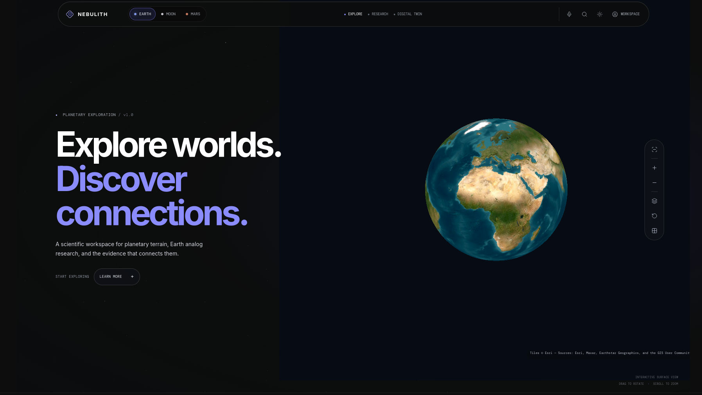
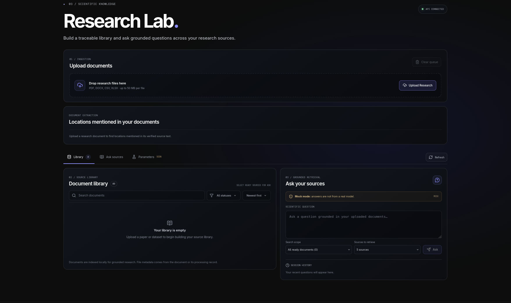
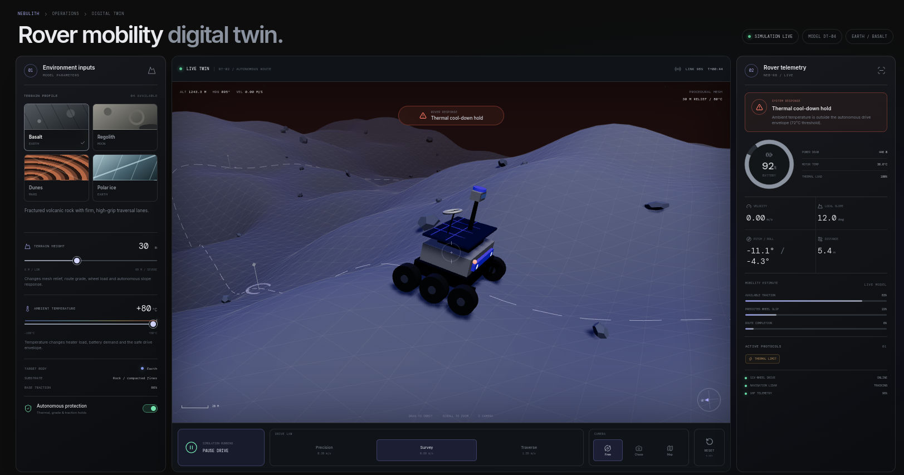
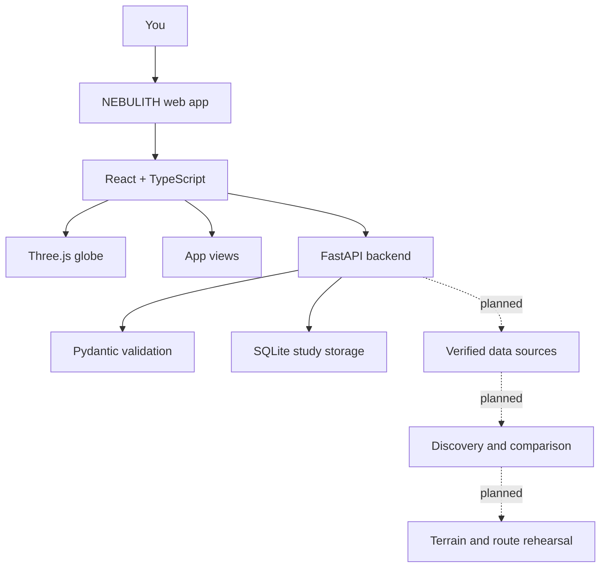

# NEBULITH

An interactive planetary explorer for Earth, the Moon and Mars, slowly turning into a research workspace.


## Live App

**[Launch NEBULITH](https://nebulith.netlify.app/)**

## Frontend Preview

### Interactive Planetary Explorer



### Research Lab



### Rover Mobility Digital Twin



## What is this?

Say you're staring at some dark, rocky desert that looks a lot like a photo from Mars. Could a place like that tell you anything about how a rover would drive on another planet? What carries over, and what definitely doesn't?

That's the question behind NEBULITH. Scientists already use "terrestrial analogues" (deserts, volcanic fields, salt flats, polar regions, high-altitude terrain) to prepare experiments and study exploration conditions. This project is an attempt to put the pieces in one place: pick a world, pick an area, look at the evidence, and see what the location can and can't tell you.

The catch is that an Earth site is never a copy of another world. A rocky desert says something about terrain, but it can't reproduce Martian air pressure, lunar gravity or the radiation outside Earth's magnetic field. A lot of how this project is designed comes from taking that seriously.

It's still early. The globe is the part that works today. The research and analysis parts are being built in stages.

## What works right now

This is a foundation, not a finished planetary science tool.

**The globe.** An interactive 3D view of Earth, the Moon and Mars. You can switch between them, rotate, zoom, reset the view, and toggle the grid and Earth's clouds.

The textures are illustrative only. They look nice, but they aren't scientific raster data, so please don't draw geological or environmental conclusions from them.

**Place search.** There's a demo search by place name or coordinates, plus a panel showing info about whatever you picked. The search data is small and not a verified global database, and some of the numbers in the panel are placeholders.

**Studies.** There's a basic local workspace backed by FastAPI and SQLite. You can create a study and list the ones the backend has stored. The idea is that eventually a study keeps a target, a planetary body, notes and analysis together. Right now it's just the start of that.

## Where it's going

Some of the questions I'd like the tool to eventually help with:

- Which Earth locations are worth looking at as analogues for a particular lunar or Martian environment?
- What do two places really have in common, and where does the comparison stop making sense?
- Can terrain be compared using measurements with compatible units, resolution and context?
- What would a rover route across an area look like, given real elevation data and assumptions that are written down?

Roughly, the plan breaks into five pieces:

1. **A real workspace.** A study that sticks around: target body, area of interest, research question, data sources, results.
2. **Analog discovery.** Narrowing Earth locations using measurable characteristics and a small curated set of candidates. No mystery score where the biggest number gets treated as the answer.
3. **Side-by-side comparison.** Show the working: units, dates, coverage and sources stay visible. If a value is missing, say it's missing. Missing elevation is not elevation zero.
4. **Transferability.** A site can be a good analogue for one thing and a bad one for another. Geology, terrain and operational suitability shouldn't get mashed into one vague "similar".
5. **Terrain and route rehearsal.** A bounded 3D terrain view and some basic route experiments, built on real elevation data with a documented source and reference system. A route on screen is a planning aid, not proof a rover could drive it.

## Status

A screen existing in the app doesn't mean the science behind it is done, so here's the honest version.

| Part | Status |
|---|---|
| React app and visual shell | Done |
| Earth / Moon / Mars globe | Done |
| Planet switching, rotation, zoom, view controls | Done |
| Demo place and coordinate search | Done |
| Location info panel | Done, some values are placeholders |
| Original routes | Kept |
| New research-workflow routes | Added as placeholders |
| Local mission workspace | Basic version |
| FastAPI + Pydantic backend | In progress |
| SQLite study create/list | Basic version |
| Health endpoint and API docs | Available locally |
| Verified data sources and ingestion | Not done |
| Area-of-interest geometry and 2D map | Not done |
| DEM-backed 3D terrain | Not started |
| Analog discovery and similarity scoring | Not started |
| Transferability analysis | Not started |
| Rover route planning | Not started |
| Reproducible reports and exports | Planned |

The integration plan tracks 68 plans and 311 task IDs, and the progress counter still says 0/311. That doesn't mean nothing works. It means the full acceptance criteria for those bigger tasks haven't been met.

## Tech

**Frontend:** React 19, TypeScript 5.7, Vite 6, React Router 7, Three.js for the globe, Lucide for icons. MapLibre GL is installed for the planned 2D map but isn't really used yet.

**Backend:** Python, FastAPI, Pydantic, SQLite.

The research side will need more than that: real datasets, a way to track where each one came from, and methods you can check and repeat. Source, date, coverage, resolution, units, uncertainty and processing details matter as much as the picture on screen.

If language-model features ever get added, they should explain evidence, not make it up or replace the actual calculation.

## Architecture

The frontend and backend are split today. The dashed parts are where this is heading, not live integrations.



One design decision worth mentioning: the 3D globe, the scientific 2D map and the bounded 3D terrain scene are meant to be three separate things. The globe is for orientation, the map is for picking areas and layers, and the terrain scene will eventually use real elevation for one region. Keeping them apart stops a pretty visual from passing as a measurement.

## Project layout

```text
NEBULITH/
├── backend/                    # FastAPI backend
├── src/                        # React + TypeScript app
├── public/                     # static files, planet textures
├── scripts/                    # utility scripts
├── planning/
│   └── terracroma-prototype/   # original planning and specs
├── .opencode/skills/           # project-specific agent instructions
├── .vscode/                    # editor config
├── DESIGN.md
├── NEBULITH-FEATURE-MAPPING.md
├── NEBULITH-INTEGRATION-PLAN.md
├── index.html
├── package.json
├── package-lock.json
├── tsconfig.json
└── vite.config.ts
```

The `planning/terracroma-prototype/` folder is on purpose. It has the original planning material that led to the current direction. The app and repo are both called NEBULITH.

## Running it locally

You need Node.js with npm, Python 3.10 or newer, and Git.

```bash
git clone https://github.com/yugal-07/NEBULITH.git
cd NEBULITH
npm install
npm run dev
```

Vite prints a local URL, usually `http://localhost:5173`. The frontend works fine on its own.

For the backend, open a second terminal in the repo root:

```bash
python -m venv .venv
source .venv/bin/activate        # Windows PowerShell: .venv\Scripts\Activate.ps1
pip install -r backend/requirements.txt
uvicorn main:app --app-dir backend --reload
```

The API runs at `http://127.0.0.1:8000`, with docs at `/docs` and a health check at `/health`. Keep both terminals open if you're using anything that talks to the API.

If setup breaks, check `backend/requirements.txt`, `package.json` and the integration plan in the same checkout. Things are changing quickly and commands may too.

## Routes

The original paths are kept, and there are new ones for the research workflow.

| Path | What it is |
|---|---|
| `/` | Landing page / planetary explorer |
| `/explore` | Interactive globe |
| `/discover` | Existing discovery entry |
| `/research` | Research workspace |
| `/compare` | Existing comparison entry |
| `/analyze` | Analysis navigation |
| `/reports` | Reports |
| `/workspace` | Mission study workspace |
| `/explorer` | Area-of-interest and map workflow |
| `/discovery` | Analog candidate discovery |
| `/comparison` | Side-by-side comparison |
| `/transferability` | Earth-to-planet condition gaps |
| `/rehearsal` | Terrain and route rehearsal |

Several of these are placeholders for now. A route existing doesn't mean the workflow behind it is finished.

## Principles

Planetary research is a field where a confident-looking answer can be worse than no answer. These are the rules the project is being shaped around.

- **An analogue is not a twin.** A site can help with one part of a study without matching the conditions of the Moon or Mars.
- **Don't turn missing data into a number.** If it's unavailable, show it as unavailable. Zero is a real value.
- **Keep the source attached.** A measurement should trace back to its dataset, date, resolution, units and processing where that's known.
- **Compare fairly.** Similar names aren't enough. Units, scale, context and method have to line up.
- **Explanation is not calculation.** An AI-written summary can help, but it can't stand in for a reproducible method.
- **Know what a simulation proves.** A route on screen is a way to explore an idea, not evidence that a rover can drive it safely.

NEBULITH is an independent project and isn't affiliated with or endorsed by NASA.

## What's next

1. Finish the shared interface and make the workspace and explorer flows hang together.
2. Build the area-of-interest workflow and hook up a real 2D map.
3. Set up verified data sources and keep provenance with the data.
4. Start with a few defensible analog candidates instead of pretending to scan the whole planet.
5. Add explainable comparisons and environmental gaps.
6. Bring in a real elevation dataset for a limited terrain and route experiment.
7. Add references, reproducible reports and exports.

Order matters here. A similarity score is pointless before the measurements behind it can be trusted, and a terrain simulator built on invented terrain is worse than none.
