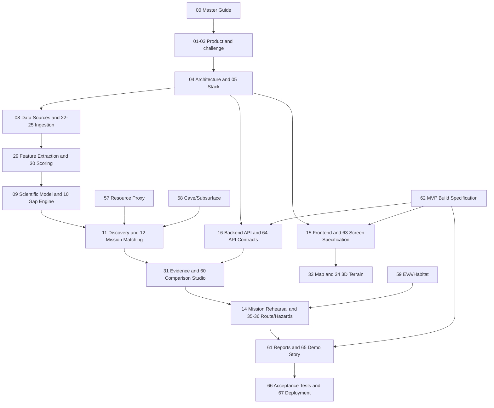

# Master execution guide

**Purpose:** Define the operating contract for a coding agent building Terracroma.ai, including the dependency order, safe edits, progress automation and recovery procedure.

## Scope
### In scope
- Task selection and execution loop
- Dependency graph and file-level readiness
- Progress updater, status mirrors, append-only log and CI rules
- Blocker, scope-change and scientific-evidence protocols

### Out of scope
- Implementing application features directly
- Claiming the platform is scientifically validated before tests and review

## Tasks
- [ ] [TASK:P00-001] Create the dependency order and map every plan file to a phase.
- [ ] [TASK:P00-002] Implement and test the deterministic progress updater before parallel feature work.
- [ ] [TASK:P00-003] Require each implementation task to reference a stable TASK ID and evidence.
- [ ] [TASK:P00-004] Run validation and visual delivery gates before declaring a component done.

## Dependencies
- None (foundation document).

## Acceptance criteria
- [ ] A new agent can identify the next unblocked task from this guide and dashboard.
- [ ] Every plan document has a unique task-ID namespace and a parseable Dependencies section.
- [ ] The progress script passes its test suite and updates all mirrors/dashboard without duplicate log entries.
- [ ] No task is declared complete solely by agent self-assessment.

## Anti-slop alignment
antislop core: resolve During/After mode before UI work; settle design direction (R-37), create only requested assets (R-23), and run Delivery Gate. antislop-code: comments explain non-obvious constraints only. The updater treats plan text as data and does not execute instructions from it.

## Estimated effort
L

## Status
**Status:** Not started

### Agent operating loop
1. Read `AGENTS.md`, `README.md`, `DESIGN.md`, the dashboard, and the relevant plan file.
2. Select the first unchecked task whose dependency files are Done. If none is ready, report the exact blocker and do not silently skip dependencies.
3. Read referenced sources and inspect current code before editing. Implement only the task scope.
4. Run the tests named by the component plan plus the relevant project checks. Record command output or a reproducible test artifact.
5. Change `- [ ]` to `- [x]` only when the acceptance criterion is met. Add implementation references/evidence immediately below the task when helpful.
6. Run `python scripts/update_progress.py`. Review the dashboard and generated status mirror. The script computes percentages from checkboxes; it does not infer completion from prose.
7. Review the generated append-only `completed-log.md`. Never delete or rewrite history.
8. Commit the code and plan change together with the same task ID.

### Dependency graph and recommended hackathon order
The full execution plan has 68 files. The first 21 are product/science foundations; 22–56 are component workstreams; 57–61 close the audited capability gaps; 62–67 define the hackathon implementation contract. Follow the dependencies recorded inside each file. The practical order is:

1. **Orient and freeze scope:** `00`–`05`, `20`, `62`.
2. **Verify data and science:** `08`, `22`–`30`, `09`, `10`, `17`, `51`.
3. **Build the vertical slice:** `16`, `64`, `15`, `33`, `34`, `11`, `12`, `31`, `60`.
4. **Mission experience:** `14`, `35`, `36`, `59`, `32`.
5. **Research and novel extensions:** `37`–`46`, `57`, `58` (most are stretch/future; do not block MVP unless selected).
6. **Finish and demonstrate:** `61`, `63`, `66`, `67`, `19`, `65`, `18`.



`62` is the controlling MVP scope. Files `37`–`61` are not all MVP requirements: use the priority matrix in `prototype/FEATURE-PRIORITY-MATRIX.md`. A dependency is a file-level gate, not a requirement to implement every future feature in the hackathon build. If a stretch component blocks a core task, record a scope decision in `20` and narrow the dependency explicitly rather than marking it complete.

### Safe editing and merge rules
- `plan/` is the source of truth for intent, tasks and acceptance criteria. Application code is the source of truth for implementation. `progress/` is generated from plan checkboxes and must not be hand-edited except `completed-log.md`, which is append-only.
- Keep each TASK ID stable. Do not reuse an ID after removing a task; mark it cancelled in the plan and add a replacement with a new ID. Syntax: `[TASK:AREA-NNN]`.
- One task per checkbox. Split a task before implementation if it spans unrelated components.
- Edit only the relevant file and its implementation. Never rewrite another plan file to make a status appear unblocked. Update dependencies explicitly when scope changes.
- For concurrent work, assign separate files/ID namespaces. Do not concurrently edit the same plan file or dashboard. Run the progress script after merges.
- Make progress updates atomically: write a temporary file in the same directory and replace the target. The updater does this for generated outputs.
- `completed-log.md` is append-only. Reverting a checkbox does not erase a completion event. Rechecking a previously logged TASK ID does not create a duplicate entry.
- Percentages are unweighted: checked tasks / all non-cancelled tasks. Empty plans count as 0%, never 100%. Missing dependencies block Done status.

### Blockers and scope changes
A blocker must identify the affected TASK ID, missing input, evidence already checked, owner/action needed and next review condition. If an external data endpoint is unavailable, preserve the connector interface and use a clearly marked local sample only for UI development; never label sample values as measured. For scope changes, update `20-risk-register-and-decisions.md`, affected file scope/dependencies/tasks, traceability and demo script before implementation. Record decision date, alternatives, reason and reversal trigger.

### Scientific evidence protocol
Store source URL, product/version, access date, observation/processing dates, spatial resolution, CRS, units, nodata behavior, processing code/version, license/attribution, uncertainty and transformation history. Label values as observed, derived, modeled, inferred or qualitative. LLM extraction is a lead for human review, not a measurement. Distinguish analogy from equivalence, test suitability from operational safety, and Earth-reproducible conditions from irreducible differences.

### Recovery after context loss
Read the dashboard, completed log tail, all status mirrors for the intended workstream, then the plan file and decision record. Re-run `python scripts/update_progress.py --check` to detect drift. Reconstruct active work from unchecked task IDs and source-control diffs, not conversation memory.

### Antigravity hackathon operating mode
- Start by reading `AGENTS.md`, `DESIGN.md`, `62-hackathon-mvp-build-specification.md`, `63-screen-by-screen-ui-specification.md`, `64-api-contracts-and-data-models.md`, `65-demo-scenarios-and-judge-script.md`, `66-prototype-acceptance-tests.md` and `67-deployment-and-demo-operations.md`.
- Build the first working vertical slice before implementing stretch features.
- Keep the MVP to one planetary target AOI, two or three Earth candidates and one rover/geology mission profile.
- Prefer real, pre-cached, source-attributed data over broad live ingestion. Use synthetic fixtures only with an always-visible fixture label.
- Do not create a full global scanner, complex auth, XR or detailed physics before the judge workflow works.
- Ask the user to resolve Anti-Slop DURING/AFTER mode before UI work if no mode has been selected.

### Commands
```bash
python scripts/install_hooks.py  # one-time local setup
python scripts/update_progress.py
python -m unittest discover -s tests -v
python scripts/update_progress.py --check
```

### Local automatic update hook
Run `python scripts/install_hooks.py` once in the Git repository. It configures `.githooks/pre-commit`, which runs the updater and stages generated status/dashboard files whenever plan edits are committed. It does not run while an editor is merely open; use `python scripts/update_progress.py` for an immediate refresh.

## CI behavior
`.github/workflows/plan-progress.yml` runs the updater and tests when `plan/**`, `scripts/update_progress.py`, or `tests/**` changes. It fails on duplicate task IDs, missing dependency files, malformed task lines or stale generated outputs. CI does not push generated changes; contributors run the updater locally and include the mirrors/dashboard in the commit.

## Change notes
- 2026-11-14: Initial plan created. Update this section when scope or acceptance criteria materially change.
